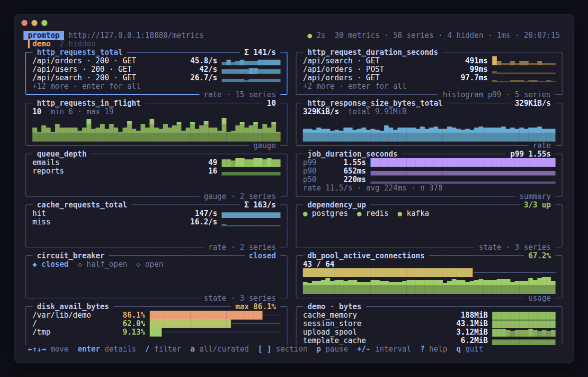
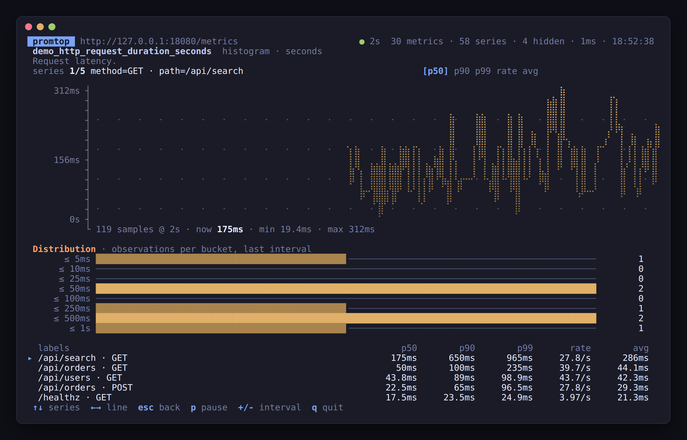
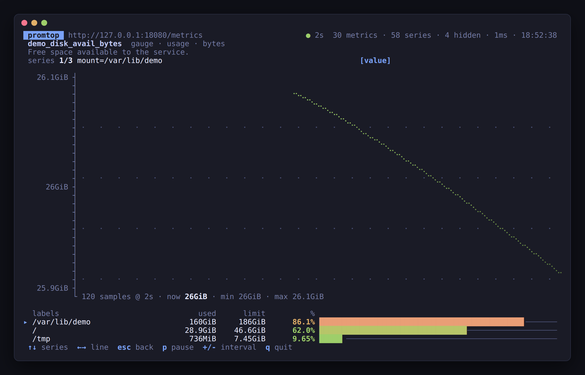

# promtop

`top` for Prometheus metrics. Point it at a service's `/metrics` endpoint and get a live terminal
dashboard — no Prometheus server, no Grafana, no config. Every metric gets a widget chosen from its
type, name and values, so any exporter works: your service, node_exporter, blackbox, kube-state-metrics.

```sh
promtop 8080            # http://localhost:8080/metrics
promtop db-1:9187       # http://db-1:9187/metrics
promtop https://svc.example/internal/metrics -H "Authorization: Bearer $TOKEN"
promtop ./dump.prom     # an exposition saved to a file
```



<table><tr>
<td></td>
<td></td>
</tr></table>

*The bundled demo (`go run ./examples/demo`): enter opens a full-size chart with every series,
histograms show their bucket distribution.*

## Install

```sh
go install github.com/igorrius/promtop@latest
```

or download a ready-made build from [Releases](https://github.com/igorrius/promtop/releases):
archives for Linux, macOS, Windows and FreeBSD (amd64, arm64, armv7), and Linux packages:

```sh
sudo dpkg -i promtop_*_linux_amd64.deb                  # Debian, Ubuntu
sudo rpm -i promtop_*_linux_amd64.rpm                   # Fedora, RHEL
sudo apk add --allow-untrusted promtop_*_linux_amd64.apk # Alpine
sudo pacman -U promtop_*_linux_amd64.pkg.tar.zst        # Arch
```

promtop is a single static binary; the terminal UI is built on [Bubble Tea](https://github.com/charmbracelet/bubbletea) and
[Lip Gloss](https://github.com/charmbracelet/lipgloss), so it adapts to the terminal's colour
support and light or dark background and works on Linux, macOS, BSD and Windows alike.

## How widgets are chosen

| Metric                                                 | Widget                                                        |
|--------------------------------------------------------|---------------------------------------------------------------|
| `counter`                                              | per-second rate with sparkline; Σ of all series in the title  |
| `counter` named `*_bytes_total`                        | throughput, `KiB/s`                                           |
| `counter` named `*_seconds_total`                      | utilisation in % (e.g. `process_cpu_seconds_total` → CPU %)    |
| `gauge`                                                | current value, min/max over the window, sparkline             |
| `histogram`                                            | p50/p90/p99 computed from bucket **deltas** between scrapes, rate, average; bucket distribution in details |
| `summary`                                              | client-side quantiles, rate, average                          |
| gauge with a sibling limit                             | usage bar: `open`/`used`/`allocated` vs `max`/`limit`/`size`, `avail`/`free` vs `size`/`total` (shown as used), `MemFree` vs `MemTotal`; matched per series by labels (`node_filesystem_avail_bytes` per mount point) |
| 0/1 gauge named `up`, `*_up`, `*_success`, `*_ready`, `*_healthy`, … ; `stateset` | state chips, problems first; history strip in details |
| `*_info`, `*_build_info`, `*_labels`, `info`           | label table                                                   |
| gauge holding a unix time and named `*time*`, `*timestamp*`, `*last*`, `*expiry*`, … | age / uptime / time left (seconds or milliseconds) |
| untyped `*_total`                                      | treated as a counter                                          |

Units come from metric-name suffixes (`_bytes`, `_seconds`, `_milliseconds`, `_ratio`, `_percent`,
`_celsius`, `_bits`, …) or an OpenMetrics `# UNIT` line.

Layout:

* Metrics are grouped into sections by name prefix (`http_`, `db_`, your namespace…; dots and
  colons separate tokens too). Crowded prefixes are split further — `node · memory`,
  `node · zfs · arc` — and small leftovers stay in the parent section.
* In a crowded section, single-series gauges and counters with the same unit are packed into one
  group panel with a row per metric, so dozens of `node_memory_*_bytes` take one panel.
* `go_`, `process_` and `promhttp_` runtime sections go last. Well-known runtime metrics are ordered
  by usefulness — both `client_golang` collectors (`go_goroutines`, `go_memstats_*`) and
  OpenTelemetry runtime semantic conventions (`go_goroutine_count`, `go_memory_used_bytes`).
* Hidden until you press `a`: metrics that stayed at zero for the whole window, limits already shown
  in a usage panel, and Go runtime internals (most of `go_memstats_*`, `promhttp_*`).
* Labels shared by every series of a metric, and OpenTelemetry `otel_scope_*` labels, are hidden.
  Multi-series rows list the most distinguishing label first.
* `target_info` (OpenTelemetry resource) is shown in the header as the service name.

## Keys

| Key                   | Action                                          |
|-----------------------|-------------------------------------------------|
| `←↑↓→` / `hjkl`       | move between panels                             |
| `[` / `]`             | previous / next section                         |
| `enter`               | details: large chart, every series, buckets     |
| `↑↓` (details)        | choose a series                                 |
| `←→` / `tab` (details)| choose a line (p99, p50, rate, avg, …)          |
| `/`                   | filter by regex, `tab` completes a metric name (`c` clears) |
| `a`                   | show all metrics / curated                      |
| `p`, `space`          | pause                                           |
| `+` / `-`             | longer / shorter scrape interval                |
| `?`                   | help                                            |
| `esc`, `q`            | back / quit                                     |

The mouse works too: click a panel to select it, click it again for details, scroll with the
wheel, right-click to go back.

## Flags

```
-i duration       scrape interval (default 2s)
-H "Name: value"  extra request header, repeatable
-f regex          only show matching metrics
-a                show all metrics, including runtime noise
-history n        samples kept per series (default 300)
-timeout d        scrape timeout (default: interval, at most 10s)
-once             scrape twice, print one frame and exit (CI, logs, screenshots)
-width n          width for -once
-no-color         disable colours (NO_COLOR is honoured too)
```

## Try it

```sh
go run ./examples/demo &   # synthetic metrics of every type on :8080
go run . 8080
```

## Notes

* Rates and histogram quantiles need two scrapes; the first frame shows lifetime values.
* Histogram quantiles use the same linear interpolation as PromQL `histogram_quantile`.
* The text exposition format (`text/plain; version=0.0.4`) is requested; OpenMetrics
  suffixes (`_total`, `_created`, `# EOF`) are understood as well.

## Development

```sh
make test       # vet + race tests
make lint       # golangci-lint (.golangci.yml)
make snapshot   # every release archive and package in dist/, nothing published
make screenshots # docs/*.png and docs/promtop.gif from the demo (needs Chrome and ffmpeg)
```

Releases are built by GoReleaser in CI: push a `v*` tag and the release with all archives,
packages and checksums appears on GitHub. Every CI run also uploads a snapshot build as an artifact.

## License

MIT
