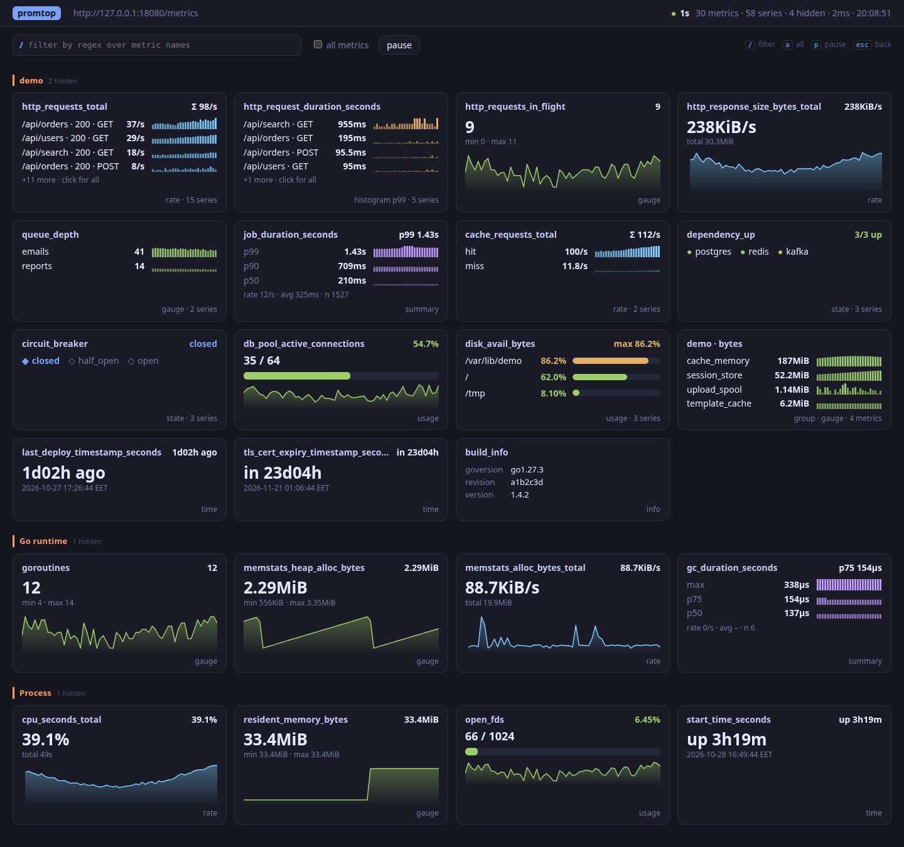
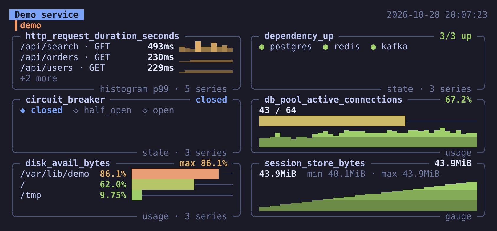

# promtop

`top` for Prometheus metrics. Point it at a service's `/metrics` endpoint and get a live terminal
dashboard — no Prometheus server, no Grafana, no config. Every metric gets a widget chosen from its
type, name and values, so any exporter works: your service, node_exporter, blackbox, kube-state-metrics.

```sh
promtop 8080            # http://localhost:8080/metrics
promtop db-1:9187       # http://db-1:9187/metrics
promtop https://svc.example/internal/metrics -H "Authorization: Bearer $TOKEN"
promtop ./dump.prom     # an exposition saved to a file
```


<table><tr>
<td></td>
<td></td>
</tr></table>

*The bundled demo (`go run ./examples/demo`): enter opens a full-size chart with every series,
histograms show their bucket distribution.*

## Web dashboard

```sh
promtop -web 8080
```

Serves the same dashboard as a web page on a free localhost port and opens it in the browser:
cards with charts, hover values and drag-to-zoom in the details, a filter with metric-name
completion, and light or dark theme following the system. The URL keeps the filter and the open
metric (`#filter=http&metric=…`), so a link reopens the same view. The page only answers to
`localhost`; `-web-addr 0.0.0.0:9999` exposes it to the network on purpose. `$BROWSER` picks the
browser (`BROWSER=true` just prints the URL).

From the terminal UI, `w` starts the same page on the side and opens it; the footer shows its
URL. It is fed by the terminal's scrapes, so it follows its interval and pause, and its history
starts at the press.



## Embed in your service

The web dashboard is also a Go package: register it next to `/metrics` and the service shows its
own metrics in the browser while it runs — handy when you are writing the metrics and want to see
them right away, without a Prometheus or OpenTelemetry stack.

```sh
go get github.com/igorrius/promtop/dash
```

```go
mux.Handle("/metrics", promhttp.Handler())

metrics := promhttp.HandlerFor(prometheus.DefaultGatherer, promhttp.HandlerOpts{})
mux.Handle("/webmetrics/", dash.New(metrics, dash.Title("orders-svc"))) // http://localhost:8080/webmetrics/
```

The dashboard calls the metrics handler in-process every interval: no network, no port, no
second process. Anything that serves the Prometheus text format works — client_golang,
OpenTelemetry's Prometheus exporter, VictoriaMetrics/metrics. Give it a handler that does not
count its own calls (`HandlerFor` without `HandlerOpts.Registry`, as above): `promhttp.Handler()`
does, and every poll would show up in `promhttp_metric_handler_requests_total` for your real
scrapers. The requests carry `User-Agent: promtop-dash/<version>` if your middleware wants to
skip them. It mounts under any path; `/webmetrics` redirects to `/webmetrics/`.

Who gets to see it:

| `dash.Allow(…)` | Admits | Notes |
|---|---|---|
| `dash.Localhost` (default) | loopback clients naming a loopback host | Works on a dev machine and through `kubectl port-forward`; ingress and other pods get 403. A reverse-proxy sidecar on localhost looks local too. |
| `dash.PrivateNetwork` | loopback and private addresses (10/8, 172.16/12, 192.168/16, fc00::/7) | For Docker, docker-compose, WSL2 and local VMs, where the host's browser arrives from a bridge address. In Kubernetes it opens the dashboard to the whole cluster network. |
| `dash.Anyone` | everyone | |
| your own `func(*http.Request) bool` | what it says | Compose with the above, e.g. `dash.Localhost(r) \|\| vpn.Contains(addr)`. |

For a login, wrap the handler in your own auth middleware and let it in with `dash.Allow(dash.Anyone)`:
the page and its event stream are plain same-origin requests, so cookies and basic auth reach it,
custom headers do not. The dashboard shows the same data as `/metrics` next to it. Turning it on per environment is up to
the service, e.g.:

```go
if os.Getenv("DEBUG_DASH") != "" {
    mux.Handle("/webmetrics/", dash.New(metrics))
}
```

Options: `dash.Interval` (default 2s), `dash.History` (samples kept per series, default 300),
`dash.Filter` (initial filter regex; one in the page URL wins), `dash.Title` (page header, default
"this process"). The dashboard lives as long as the process, like `/metrics`. `Close` stops polling
and ends open browser streams; hook it to graceful shutdown, otherwise `Shutdown` waits for an open
tab until its context expires:

```go
d := dash.New(metrics)
mux.Handle("/webmetrics/", d)
srv.RegisterOnShutdown(func() { _ = d.Close() })
```

Do not `defer d.Close()` in a function that only builds the router: the dashboard would be closed
before the first request and answer 503. The package needs Go 1.27.3 or later. A runnable service
with client_golang is in [`examples/embedded`](examples/embedded) (`make embedded`).

## Snapshots for chats, bots and reports

`promtop render` reads the metrics once and draws them into a file — PNG or SVG to send to a
Telegram chat or attach to a report, JSON for a bot that wants the numbers, or text. A pipeline or
an AI agent scrapes, looks at the data and sends a picture people can read at a glance.

```sh
promtop render -o dash.png 9100                       # the whole dashboard
promtop render -m node_load1 -for 1m -o load.svg 9100 # one metric: its detail chart
promtop render -m 'battery_*' -m 'inverter_*' -title Inverter -o - 192.168.1.50:9100 \
  | curl -sF chat_id="$CHAT" -F photo=@- "https://api.telegram.org/bot$TOKEN/sendPhoto"
promtop render -m 'battery_*' -format json 192.168.1.50:9100   # the data behind the picture
```



**What is drawn.** `-m glob` (repeatable) and `-f regex` select metrics, `-l` selects series with
Prometheus-style label matchers (`mount=/data`, `sensor=~kitchen.*`, `dev!=lo`). With one metric
selected you get its detail view — big chart, bucket distribution, every series — otherwise the
grid; `-view grid|detail` forces either.

**History.** A single read has no history: promtop scrapes twice, `-i` apart, so rates have a
value, and `-for 1m` samples longer before drawing. For hours or days without a Prometheus server,
let cron collect samples into a small state file and draw from it:

```sh
# crontab: a sample every 5 minutes, the last 300 kept (25 hours)
*/5 * * * *  promtop record -state ~/.cache/inverter.state -m 'battery_*' 192.168.1.50:9100

# whenever you want the picture
promtop render -state ~/.cache/inverter.state -m 'battery_*' -o battery.png 192.168.1.50:9100
```

`render -state` adds its own scrape to the file (one that comes right after the cron run replaces
the cron sample, so rates do not cover a few seconds); `-offline` draws the file without scraping.
The file stores only the selected metrics, so select the limit of a usage bar too
(`-m 'node_filesystem_*'`, not just `*_avail_bytes`).

| Flag | Meaning |
|------|---------|
| `-o file` | output, `-` for stdout (the default); the extension picks the format |
| `-format f` | `png`, `svg`, `json`, `txt` or `ansi` |
| `-m glob`, `-f regex`, `-l matcher` | select metrics and series |
| `-view v` | `auto` (details for one metric), `grid` or `detail` |
| `-for d`, `-i d` | sample for `d`, every `-i` |
| `-state file`, `-keep n`, `-offline` | draw a history file (and add to it) |
| `-title t`, `-theme dark\|light` | header title, colours |
| `-width n`, `-height n`, `-scale x` | width in cells (default 90: two columns), detail chart rows, pixel scale (default 2) |
| `-style s` | picture style; `terminal` for now — the same panels as the terminal UI |

Images are drawn in pure Go with an embedded DejaVu Sans Mono font; box drawing, bars and braille
charts are geometry, so they join up at any scale. No browser, no server.

## Install

```sh
go install github.com/igorrius/promtop@latest
```

or download a ready-made build from [Releases](https://github.com/igorrius/promtop/releases):
archives for Linux, macOS, Windows and FreeBSD (amd64, arm64, armv7), and Linux packages:

```sh
sudo dpkg -i promtop_*_linux_amd64.deb                  # Debian, Ubuntu
sudo rpm -i promtop_*_linux_amd64.rpm                   # Fedora, RHEL
sudo apk add --allow-untrusted promtop_*_linux_amd64.apk # Alpine
sudo pacman -U promtop_*_linux_amd64.pkg.tar.zst        # Arch
```

promtop is a single static binary; the terminal UI is built on [Bubble Tea](https://github.com/charmbracelet/bubbletea) and
[Lip Gloss](https://github.com/charmbracelet/lipgloss), so it adapts to the terminal's colour
support and light or dark background and works on Linux, macOS, BSD and Windows alike.

## How widgets are chosen

| Metric                                                 | Widget                                                        |
|--------------------------------------------------------|---------------------------------------------------------------|
| `counter`                                              | per-second rate with sparkline; Σ of all series in the title  |
| `counter` named `*_bytes_total`                        | throughput, `KiB/s`                                           |
| `counter` named `*_seconds_total`                      | utilisation in % (e.g. `process_cpu_seconds_total` → CPU %)    |
| `gauge`                                                | current value, min/max over the window, sparkline             |
| `histogram`                                            | p50/p90/p99 computed from bucket **deltas** between scrapes, rate, average; bucket distribution in details |
| `summary`                                              | client-side quantiles, rate, average                          |
| gauge with a sibling limit                             | usage bar: `open`/`used`/`allocated` vs `max`/`limit`/`size`, `avail`/`free` vs `size`/`total` (shown as used), `MemFree` vs `MemTotal`; matched per series by labels (`node_filesystem_avail_bytes` per mount point) |
| 0/1 gauge named `up`, `*_up`, `*_success`, `*_ready`, `*_healthy`, … ; `stateset` | state chips, problems first; history strip in details |
| `*_info`, `*_build_info`, `*_labels`, `info`           | label table                                                   |
| gauge holding a unix time and named `*time*`, `*timestamp*`, `*last*`, `*expiry*`, … | age / uptime / time left (seconds or milliseconds) |
| untyped `*_total`                                      | treated as a counter                                          |

Units come from metric-name suffixes (`_bytes`, `_seconds`, `_milliseconds`, `_ratio`, `_percent`,
`_celsius`, `_bits`, …) or an OpenMetrics `# UNIT` line.

Layout:

* Metrics are grouped into sections by name prefix (`http_`, `db_`, your namespace…; dots and
  colons separate tokens too). Crowded prefixes are split further — `node · memory`,
  `node · zfs · arc` — and small leftovers stay in the parent section.
* In a crowded section, single-series gauges and counters with the same unit are packed into one
  group panel with a row per metric, so dozens of `node_memory_*_bytes` take one panel.
* `go_`, `process_` and `promhttp_` runtime sections go last. Well-known runtime metrics are ordered
  by usefulness — both `client_golang` collectors (`go_goroutines`, `go_memstats_*`) and
  OpenTelemetry runtime semantic conventions (`go_goroutine_count`, `go_memory_used_bytes`).
* Hidden until you press `a`: metrics that stayed at zero for the whole window, limits already shown
  in a usage panel, and Go runtime internals (most of `go_memstats_*`, `promhttp_*`).
* Labels shared by every series of a metric, and OpenTelemetry `otel_scope_*` labels, are hidden.
  Multi-series rows list the most distinguishing label first.
* `target_info` (OpenTelemetry resource) is shown in the header as the service name.

## Keys

| Key                   | Action                                          |
|-----------------------|-------------------------------------------------|
| `←↑↓→` / `hjkl`       | move between panels                             |
| `[` / `]`             | previous / next section                         |
| `enter`               | details: large chart, every series, buckets     |
| `↑↓` (details)        | choose a series                                 |
| `←→` / `tab` (details)| choose a line (p99, p50, rate, avg, …)          |
| `/`                   | filter by regex, `tab` completes a metric name (`c` clears) |
| `a`                   | show all metrics / curated                      |
| `p`, `space`          | pause                                           |
| `+` / `-`             | longer / shorter scrape interval                |
| `w`                   | open the web dashboard (started on first press) |
| `?`                   | help                                            |
| `esc`, `q`            | back / quit                                     |

The mouse works too: click a panel to select it, click it again for details, scroll with the
wheel, right-click to go back.

## Flags

```
-i duration       scrape interval (default 2s)
-H "Name: value"  extra request header, repeatable
-f regex          only show matching metrics
-a                show all metrics, including runtime noise
-history n        samples kept per series (default 300)
-timeout d        scrape timeout (default: interval, at most 10s)
-once             scrape twice, print one frame and exit (CI, logs, screenshots)
-width n          width for -once
-no-color         disable colours (NO_COLOR is honoured too)
-web              serve the dashboard over HTTP and open it in the browser
-web-addr addr    listen address for -web and the w key (default 127.0.0.1:0, a free local port)
```

`promtop render -h` and `promtop record -h` list the flags of the snapshot commands.

## Try it

```sh
go run ./examples/demo &   # synthetic metrics of every type on :8080
go run . 8080
```

## Notes

* Rates and histogram quantiles need two scrapes; the first frame shows lifetime values.
* Histogram quantiles use the same linear interpolation as PromQL `histogram_quantile`.
* The text exposition format (`text/plain; version=0.0.4`) is requested; OpenMetrics
  suffixes (`_total`, `_created`, `# EOF`) are understood as well.

## Development

```sh
make test       # vet + race tests, including the examples/embedded module
make lint       # golangci-lint (.golangci.yml)
make snapshot   # every release archive and package in dist/, nothing published
make screenshots # docs/*.png and docs/promtop.gif from the demo (needs Chrome and ffmpeg)
```

Releases are built by GoReleaser in CI: push a `v*` tag and the release with all archives,
packages and checksums appears on GitHub. Every CI run also uploads a snapshot build as an artifact.

To write the notes by hand, publish the release in the GitHub UI with a new `v*` tag: the tag
starts the same job, which finds the release by its tag, keeps the notes and adds the files.
Two things break it: a release left as a draft (GoReleaser looks releases up by tag, and drafts
have none yet, so it creates a second one) and immutable releases, which accept no files once
published.

What comes next is in [ROADMAP.md](ROADMAP.md).

## License

MIT
